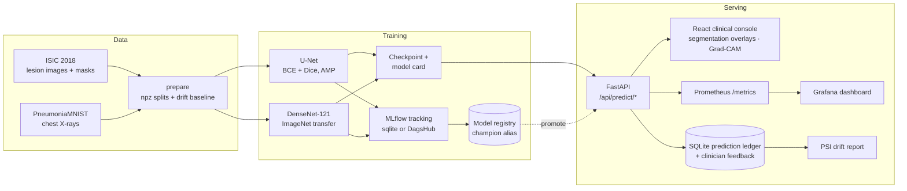

# MedMLOps — Medical Image Analysis, End to End

A complete, reproducible MLOps platform for medical imaging: a **U-Net** that segments skin lesions
(ISIC 2018) and a **DenseNet-121** that detects pneumonia on chest X-rays (PneumoniaMNIST), wrapped
in experiment tracking, a model registry, a custom clinical console, drift monitoring and a
CI/CD + Docker deployment story.

> **Not a medical device.** Research and education only. Every prediction must be reviewed by a
> qualified clinician.

---

## What makes it different

| Capability | Where it lives |
| --- | --- |
| Two imaging tasks in one platform (segmentation **and** classification) | `src/medmlops/models`, `configs/` |
| Custom **clinical console** (React + TypeScript, canvas overlays, Grad-CAM, live training console) | `web/` |
| MLflow tracking + registry with automatic **`champion` alias** promotion | `src/medmlops/tracking.py` |
| One-flag **DagsHub** switch for cloud experiment tracking | `.env`, `--dagshub`, `MEDMLOPS_TRACKER` |
| **PSI drift detection** on interpretable image features + clinician feedback loop | `src/medmlops/monitor.py` |
| **Prometheus metrics** + provisioned Grafana dashboard | `api/metrics.py`, `docker/grafana/` |
| Reproducible **DVC pipeline** (download → prepare → train → evaluate) | `dvc.yaml` |
| **FastAPI** inference with U-Net flip-TTA uncertainty and Grad-CAM explanations | `api/`, `src/medmlops/explain.py` |
| Model cards generated for every registered run | `src/medmlops/report.py` |
| GitHub Actions: tests, GHCR image builds, scheduled **retraining** | `.github/workflows/` |

## Architecture



## Repository layout

```
configs/              YAML configs for both tasks (data, model, training, output, MLflow)
src/medmlops/
  data/               ISIC + MedMNIST loaders, transforms, drift reference statistics
  models/             U-Net and DenseNet-121
  train.py            shared training engine: AMP, warmup+cosine, early stop, MLflow
  evaluate.py         held-out evaluation from a checkpoint
  tracking.py         MLflow, registry, champion promotion, DagsHub
  monitor.py          prediction ledger, feedback, PSI drift
  predictor.py        inference service shared by API and CLI
  explain.py          Grad-CAM, flip-TTA uncertainty
  cli.py              data / train / evaluate / predict / registry / serve
api/                  FastAPI app, routers, background training jobs, Prometheus metrics
web/                  React 18 + Vite + TypeScript clinical console
docker/               Dockerfiles, nginx, Prometheus and Grafana provisioning
dvc.yaml              Reproducible pipeline definition
tests/                Unit, integration and API contract tests
scripts/smoke_test.py Live end-to-end smoke test
docs/                 Runbook and model-card notes
```

---

## Quickstart

Requirements: Python 3.11+ (3.12 recommended), Node 20+, and optionally Docker. On Windows use
Git Bash; the Makefile picks `.venv/Scripts/python.exe` automatically.

```bash
# 1) Environment
uv venv --python 3.12 .venv
make install                 # Python extras + web dependencies

# 2) Data (≈3 GB ISIC mirror + 214 MB PneumoniaMNIST)
make download                # download raw data
make data                    # build npz splits, manifests, drift baselines

# 3) Train both models (MLflow tracking is local by default)
make train-seg               # U-Net, 30 epochs with early stopping
make train-clf               # DenseNet-121, 10 epochs with early stopping

# 4) Serve the API + built console on http://127.0.0.1:8000
make web-build
make serve

# or develop with hot reload
make api                     # terminal 1: FastAPI on :8000
make dev                     # terminal 2: Vite on :5173 (proxies /api)

# 5) Verify
make test
python scripts/smoke_test.py
```

Open **http://127.0.0.1:8000** for the console, **/docs** for OpenAPI, **/metrics** for Prometheus.
Run `make mlflow` for the MLflow UI on http://127.0.0.1:5000.

### Verified results

Both models were trained end to end on a single RTX 3050 Laptop (6 GB), registered in MLflow and
promoted to the `champion` alias. Numbers come from the held-out test split and are reproduced by
`dvc repro`:

| Task | Model | Test split | Metrics | Training |
| --- | --- | --- | --- | --- |
| Lesion segmentation (ISIC 2018) | U-Net, base 32, 7.76M params | 412 images | **Dice 0.875**, IoU 0.801, precision 0.892, recall 0.898, pixel acc 0.955, threshold 0.75 | 20 epochs, 23.7 min |
| Pneumonia detection (PneumoniaMNIST) | DenseNet-121, ImageNet init, 6.96M params | 624 images | **Accuracy 0.9615**, AUC 0.9837, sensitivity 0.9795, specificity 0.9316, ECE 0.0356 | 6 epochs (best 2), 9.3 min |

Raw numbers land in `metrics/*.json`; curves, prediction grids, ROC and confusion-matrix figures in
`artifacts/figures/`; full run metadata and generated model cards in the MLflow run.

### Datasets

* **ISIC 2018** — 2,594 lesion images with expert masks. The default source is a fast Hugging Face
  mirror (`sergiomadrid/isic_segmentation`, ~2,750 images + masks); set
  `data.source: official` to use the ~11 GB official archive instead.
* **PneumoniaMNIST** — 5,856 pediatric chest X-rays (train/val/test), downloaded through the
  `medmnist` package. Other MedMNIST datasets are supported by changing `data.name`.

Both prep stages write an `npz` split bundle, `manifest.json` (counts, class balance) and
`reference_stats.json` (per-feature histograms used by drift monitoring).

---

## Experiment tracking & the model registry

Every run logs parameters, per-epoch metrics, plots, the checkpoint, a generated `model_card.md`
and registers the model in the MLflow registry. A run becomes **champion** only if it beats the
current champion on the tracked validation metric (`val_dice` / `val_auc`).

```bash
# Local SQLite backend (default)
make mlflow                               # UI at http://127.0.0.1:5000

# Inspect and promote from the CLI
.venv/Scripts/python -m medmlops.cli registry list
.venv/Scripts/python -m medmlops.cli registry champion --config configs/isic_unet.yaml
.venv/Scripts/python -m medmlops.cli registry promote --config configs/isic_unet.yaml --run-id <run_id>
```

### Switching to DagsHub

1. Create a DagsHub repo and copy the three credentials into `.env`:

```dotenv
DAGSHUB_USER_NAME=your-user
DAGSHUB_REPO_NAME=medmlops
DAGSHUB_USER_TOKEN=********
MEDMLOPS_TRACKER=dagshub
```

2. Train as usual — `dagshub.init(...)` streams runs, metrics, artifacts and registry entries to
   DagsHub-hosted MLflow:

```bash
.venv/Scripts/python -m medmlops.cli train --config configs/isic_unet.yaml --dagshub
```

GitHub Actions enables DagsHub automatically when the `DAGSHUB_USER_TOKEN` secret exists.

---

## Serving API

| Method | Path | Purpose |
| --- | --- | --- |
| GET | `/api/health` | Liveness, device, model readiness |
| GET | `/api/system` | Versions, tracking backend, dataset summaries |
| GET | `/api/models` | Loaded checkpoints + registry versions |
| POST | `/api/models/refresh` | Reload checkpoints from disk |
| POST | `/api/models/promote` | Promote a run to `champion` |
| GET | `/api/models/champion/{name}` | Champion metrics |
| GET | `/api/demo/{task}` | Held-out test image for instant demos |
| POST | `/api/predict/segmentation` | Mask, overlay, uncertainty, feature drift vector |
| POST | `/api/predict/classification` | Probabilities, calibration-friendly scores, Grad-CAM |
| POST | `/api/feedback` | Clinician verdict (`correct` / `incorrect` / `uncertain`) |
| GET | `/api/predictions/recent` | Prediction ledger |
| GET | `/api/monitoring/summary` | Volumes, latency p95, label mix, drift |
| GET | `/api/monitoring/drift` | Per-feature PSI with thresholds |
| GET | `/api/monitoring/export.csv` | Export the ledger |
| GET | `/api/experiments` | MLflow runs for the Experiments tab |
| GET | `/api/registry` | Registered models and champion |
| POST | `/api/pipeline/train` | Launch a background training job |
| GET | `/api/pipeline/jobs/{id}` | Poll job status and stream logs |
| POST | `/api/pipeline/jobs/{id}/cancel` | Stop a job |
| GET | `/metrics` | Prometheus exposition |

Segmentation responses include flip-TTA **uncertainty**; classification responses include
**Grad-CAM** overlays. Both log an interpretable feature vector (`brightness`, `contrast`,
`entropy`, `saturation`, `colorfulness`) for drift analysis.

### The console

* **Analyze** — drag & drop or load a held-out demo case; toggle TTA / Grad-CAM, inspect masks,
  uncertainty and probability bars, then submit clinician feedback.
* **Models** — loaded checkpoints, test metrics, parameter counts, run metadata and registry
  champions; reload after retraining.
* **Experiments** — MLflow runs with metric sparklines, parameter diffs and links to the run.
* **Monitoring** — volume/latency/label stats, PSI drift bars with watch/alert thresholds, recent
  predictions and a one-click CSV export.
* **Train** (inside Experiments) — start a retraining job, watch the streamed log console, and
  auto-reload the model when it finishes.

---

## Monitoring & drift

* **Ledger** — every prediction is stored in SQLite with model version, latency, features, label
  and confidence.
* **Drift** — the population stability index compares the live feature windows to training
  baselines (`reference_stats.json`). `PSI < 0.1` stable, `0.1–0.25` watch, `> 0.25` alert.
  Baselines are sampled deterministically across the whole train split (not the first N rows),
  scores are Laplace-smoothed, and PSI stays `insufficient_data` until 150 predictions accumulate
  in the window — enough samples for a 16-bin PSI to be statistically meaningful. Features are
  extracted at each model's training resolution, keeping drift measurements comparable.
* **Feedback** — clinician verdicts are joined to predictions and summarized in the console.
* **Metrics** — `medmlops_api_requests_total`, `medmlops_api_request_duration_seconds`,
  `medmlops_predictions_total`, `medmlops_prediction_duration_seconds`, `medmlops_model_ready`.
* **Dashboards** — `docker compose up` provisions Prometheus and the Grafana dashboard
  “MedMLOps · Serving overview” (admin / medmlops).

Operational guidance: [docs/runbook.md](docs/runbook.md).

---

## Reproducibility (DVC)

```bash
make repro           # run every stale stage: download → prepare → train → evaluate
dvc status           # see what would rerun (with the venv active)
dvc metrics show     # metrics/isic2018-unet-segmentation.json, metrics/medmnist-pneumonia-densenet.json
```

`make repro` puts the virtualenv on `PATH` so the `medmlops` entry point used by DVC stages
resolves on Windows and POSIX. If you call `dvc repro` directly, activate the venv first.

Training curves, prediction grids, ROC and confusion-matrix figures land in `artifacts/figures/`.

Data and artifacts are intentionally **not** committed; DVC stages regenerate them from configs.

## Docker

```bash
docker compose up --build
# console  http://localhost:8080
# api      http://localhost:8000/docs
# mlflow   http://localhost:5000
# grafana  http://localhost:3000
# prometheus http://localhost:9090
```

`docker/Dockerfile.api` builds the console and the CPU inference image; `Dockerfile.web` serves the
static console through nginx with `/api` proxying; `Dockerfile.mlflow` runs the tracking server
backed by a SQLite store mounted on a named volume.

## CI/CD

| Workflow | Trigger | What it does |
| --- | --- | --- |
| `.github/workflows/ci.yml` | push / PR | Ruff + pytest (CPU torch) + frontend type-check and build |
| `.github/workflows/docker.yml` | push to main, tags, manual | Builds and pushes API + web images to GHCR |
| `.github/workflows/retrain.yml` | weekly cron / manual | Prepares data, retrains (DagsHub when configured), evaluates, uploads artifacts |

## Configuration overrides

Any nested key can be overridden without editing YAML:

```bash
.venv/Scripts/python -m medmlops.cli train --config configs/isic_unet.yaml \
  --set training.epochs=2 data.max_samples=128 training.batch_size=8
```

## Testing

```bash
make test            # pytest: config, models, metrics, drift, transforms, explainability, API
make lint            # ruff
python scripts/smoke_test.py   # against a running server, exercises real inference
```

## Docs

* [Runbook](docs/runbook.md) — alerts, drift response, rollback, retraining.
* [Model cards](docs/model-cards.md) — what is generated and where.
* [API docs](http://127.0.0.1:8000/docs) — live OpenAPI once the server is running.

## License

MIT. Datasets retain their original licenses (ISIC 2018 and MedMNIST).
